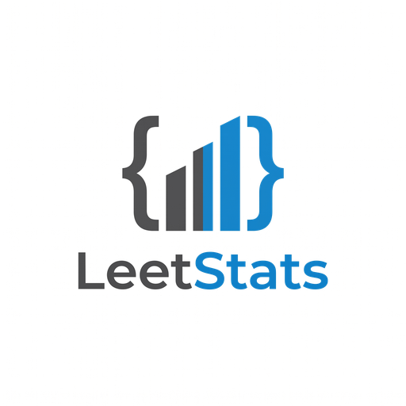

# LeetStats

LeetCode-style practice for data-science fluency: NumPy, pandas, matplotlib/seaborn,
scikit-learn, statistics and quant research. 211 short, single-concept problems you drill
until the syntax is automatic, plus open-ended interview prompts to assemble them yourself.

**Live app: https://cxmko.github.io/leetstats/**

- Runs entirely in your browser (Python via [Pyodide](https://pyodide.org)): no install, no account.
- Run against the example, submit to hidden tests, hints, solutions, spaced-repetition reviews,
  a daily queue across all sections, flashcards, a playground, 45-minute mock interviews and stats.
- Progress is saved in your browser only; use the ⋯ menu to export/import it between devices.
- Offline: download `index.html` and double-click it (Python still loads from the CDN on first use).

Building, validating and adding problems: see [DEVELOPMENT.md](DEVELOPMENT.md) and [CLAUDE.md](CLAUDE.md).

## License

[MIT](LICENSE)
